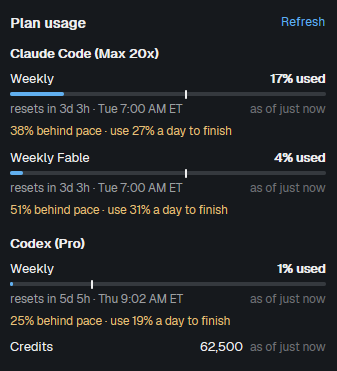

# Plan usage for Herdr

Your Claude Code and Codex limits, with a pace line, in Herdr's sidebar.

## Install

Tell your Herdr agent:

> install github.com/GeorgeMangoCoffee/herdr-plan-usage

Or by hand:

1. Copy `mods/plan-usage/` to `~/.config/herdr-app/mods/plan-usage/`.
2. Run `herdr-app check ~/.config/herdr-app/mods/plan-usage`.
3. The panel docks on the right.

Works on macOS, Linux and Windows.

## What it reads

- `~/.claude/.credentials.json`: your Claude Code login. On macOS it reads the Keychain item `Claude Code-credentials` instead.
- `~/.codex/auth.json`: your Codex login.
- `~/.codex/sessions`: Codex logs. Used only if the Codex API fails.

Tokens stay on your machine. They go only to the two endpoints below.

## What it calls

- `https://api.anthropic.com/api/oauth/usage`
- `https://chatgpt.com/backend-api/wham/usage`

Both are unofficial. They could change or break.

It polls every 5 minutes. It never refreshes your tokens. Expired? Open Claude Code or Codex once.

## The pace line

A weekly limit spans 7 days. The marker on the bar shows how much of the week has gone.

- Used less than time gone: "behind pace". You have room to spare.
- Used more: "ahead of pace". You may run out early.
- Within 2 points: "on pace".

Then a target: what's left divided by days left. Example: 24% used, 2.7 days left gives "use 28% a day to finish".

## License

MIT. See [LICENSE](LICENSE).
