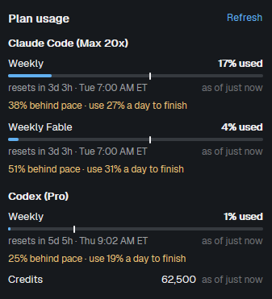

# Plan usage

A sidebar panel for your AI plan limits. It shows Claude Code and Codex. Each weekly limit gets a bar. A marker shows where you should be. A line says if you're behind or ahead. It tells you how much to use per day to finish the week.

## What you see

One block, 300px wide, docked on the right. Background `chrome`. A 1px `border` line on its left and top edges. 10px padding, 8px between parts. All colors are theme names, so it follows any theme.

Top to bottom:

1. **Header row.** "Plan usage" on the left: 13px, semibold, `foreground`. "Refresh" on the right: 11px, `accent`. It turns `foreground` on hover. It reads "Refreshing" while a fetch runs.
2. **Claude Code section.** Title "Claude Code (Max 20x)": 12px, semibold, `foreground`. The plan comes from the login: `Max 5x`, `Max 20x`, `Pro`, and so on. Rows below it:
   - "Weekly": the all-models weekly limit.
   - "Weekly <model>": one row per model-scoped weekly limit, e.g. "Weekly Fable". Accounts without scoped limits get "Weekly Opus" and "Weekly Sonnet" instead, when present.
   - The 5-hour session limit is not shown.
3. **Codex section.** Title "Codex (Pro)", same style. Rows:
   - "Weekly", plus any other window except 5-hour, shortest first.
   - "Credits": the balance with thousands separators, "Unlimited" or "None".
   - A "from log" tag (10.5px, `ansi3`) sits right of the title when the numbers came from Codex's session logs, not the API.

The two sections sit in a scroll area 10px apart.

Each limit row, 3px vertical padding, 3px gaps:

- Line 1: the name (11.5px, `foreground`) and "24% used" right-aligned (11.5px, semibold).
- Line 2: a bar, 4px tall, full width, radius 2, track `raised`. The fill is `accent` below 75%, `ansi3` from 75%, `ansi1` from 90%. The pace marker is a 2×8px `foreground` tick, radius 1, 2px above the track. It sits at the share of the window already gone.
- Line 3: "resets in 2d 17h · Tue 7:00 AM" (10.5px, `muted`) and "as of 5m ago" right-aligned (10.5px, `dim`). Times are local, 12-hour, minute-rounded, no zone label.
- Line 4: the pace line (10.5px). `ansi3` when behind, `ansi2` when on pace or ahead.

The Credits row is one line: name left; value and "as of …" right.

Messages under a section title, 10.5px:

- No login: "Not signed in to Claude Code. Run claude and log in." / "Not signed in to Codex. Run codex and log in." In `muted`.
- Signed in another way: "Claude Code isn't signed in with a Claude plan." / "Codex isn't signed in with ChatGPT." In `muted`.
- Token problems: "Claude token expired. Open Claude Code to renew it." Also "Claude token rejected.", "Codex token rejected.". In `ansi1`.
- Other failures: "Can't read Claude usage: <reason>". In `ansi1`, cut at 160 characters.
- Codex fell back to logs: the reason in `ansi3`, e.g. "API failed: Codex usage API returned 500."
- Before the first answer: "Loading." in 11px `dim`.

## How it behaves

- Fetches both services on start, then every 5 minutes. Clicking "Refresh" fetches now. A click during a fetch does nothing.
- Redraws every 60 seconds, so "resets in" and "as of" stay current.
- Data older than 1 hour turns grey. Text, bar fill and marker all use `dim`. The pace line stays, also `dim`.
- A failed fetch keeps the last good numbers on screen with the message above them.
- Pace: the window length is 7 days for weekly limits. `elapsed` is the share of the window already gone. `gap = elapsed − used`, rounded.
  - gap above 2: "37% behind pace".
  - gap below −2: "12% ahead of pace".
  - otherwise: "on pace".
  - Then " · " and a target. With a day or more left: "use 28% a day to finish". That is `(100 − used) / days left`. With under a day left: "use 40% in 5h 12m to finish".
- No pace line or marker once the reset time has passed, or with no reset time. Line 3 then reads "reset Tue 7:00 AM" or "no reset time".
- No agent status, keys or hovers beyond the Refresh link. No `keys.json`.

## Built from

- One mod, `mods/plan-usage/`: `main.js` and `mod.json` (`{ "place": "right", "size": 300, "title": "Plan usage" }`). No layout, no props, no other mods.
- `gpui-kit`: `View`, `div`. `gpui-base`: `v_flex`, `h_flex`.
- `herdr`: `theme`, `home`, `readTextFile`, `checking`, `exec`, `window` (for `platform`).
- `fs/promises`: `readdir`, `readFile` for the Codex logs. `fetch` for both APIs.
- `init` returns early when `checking()` is true. Otherwise it starts `cx.timer.every(300000, refresh)` and `cx.timer.every(60000, cx.notify)`. Both fetches run together in `cx.spawn` with `Promise.allSettled`.
- **Claude**
  - Token: `~/.claude/.credentials.json`, field `claudeAiOauth` (`accessToken`, `expiresAt`, `subscriptionType`, `rateLimitTier`).
  - On macOS the file is absent. The token is in the Keychain. Read it with `exec("security", ["find-generic-password", "-s", "Claude Code-credentials", "-w"], { timeout: 60000 })`. It prints the same JSON.
  - Call: `GET https://api.anthropic.com/api/oauth/usage` with `Authorization: Bearer <token>` and `anthropic-beta: oauth-2025-04-20`.
  - Reads `seven_day.utilization` / `resets_at`. Then `limits[]` where `kind == "weekly_scoped"` (`percent`, `resets_at`, `scope.model.display_name`). Fallback: `seven_day_opus`, `seven_day_sonnet`.
  - Plan: `rateLimitTier` matching `max_(\d+x)` gives "Max 20x". Else `subscriptionType`, capitalised.
- **Codex**
  - Token: `~/.codex/auth.json`, `tokens.access_token` and `tokens.account_id`.
  - Call: `GET https://chatgpt.com/backend-api/wham/usage` with `Authorization: Bearer <token>` and `ChatGPT-Account-Id: <account_id>`.
  - Reads `plan_type`, `rate_limit.primary_window` / `secondary_window` (`used_percent`, `limit_window_seconds`, `reset_at` in seconds), `credits` (`unlimited`, `has_credits`, `balance`).
  - Fallback when the API fails: `~/.codex/sessions/YYYY/MM/DD/rollout-*.jsonl`. Take the newest 8 files. In each, find the last line containing `"rate_limits"`. Keep the one with the latest `timestamp`. Use `payload.rate_limits.primary` / `secondary` (`used_percent`, `window_minutes`, `resets_at`), `plan_type`, `credits`.
- Programs run: only `security`, only on macOS, only when the credentials file is missing.
- No art, no icons.

## Watch out

- **Both APIs are unofficial.** Claude Code and Codex use them internally. Either can change or vanish.
- **Never refresh tokens yourself.** Refreshing rotates the refresh token. That logs the real CLI out. Show "expired" and tell the person to open the app.
- **Time zones.** The runtime has no `Intl`. `Date`'s local getters work. On Windows the runtime applies today's UTC offset to every date. A reset on the far side of a daylight-saving change shows an hour off. That is rare and harmless.
- `window()` returns null during `herdr-app check`. Fall back to `home().startsWith("/Users/")` to detect macOS.
- The first Keychain read on macOS may pop a system prompt. Allow it. Unanswered, the read times out after 60 seconds and shows "Not signed in".
- `CLAUDE_CONFIG_DIR` and `CODEX_HOME` overrides are ignored. It reads the default folders under `home()`.
- It reads this computer only, not remote machines.
- `readTextFile` caps at 1 MiB. That is fine for the token files. The session logs go through `fs.readFile`.
- Codex's 5-hour window is filtered out on purpose (`limit_window_seconds == 18000`).
- `resets_at` comes as an ISO string from Claude and as epoch seconds from Codex. Parse both. Treat numbers under 1e11 as seconds.
- A Codex login with an API key has no `tokens`. It shows "Codex isn't signed in with ChatGPT."

## Done when

- `herdr-app check ~/.config/herdr-app/mods/plan-usage` passes.
- The panel docks on the right at 300px the first time Herdr sees the folder.
- Signed in to both: each section shows the plan in its title, and the weekly rows show the same percentages as Claude Code's `/usage` and Codex's `/status`.
- Reset times read in local time with the right weekday.
- The marker sits at the share of the week gone. The pace line's numbers match `elapsed − used` and `(100 − used) / days left`.
- Renaming `~/.claude/.credentials.json` (not on macOS) shows "Not signed in to Claude Code. Run claude and log in." in `muted`, with no crash.
- With no `~/.codex` folder, the Codex section shows "Not signed in to Codex. Run codex and log in."
- On macOS with Claude Code signed in, the Claude section loads from the Keychain.
- Clicking Refresh shows "Refreshing", then updates "as of" to "just now".
